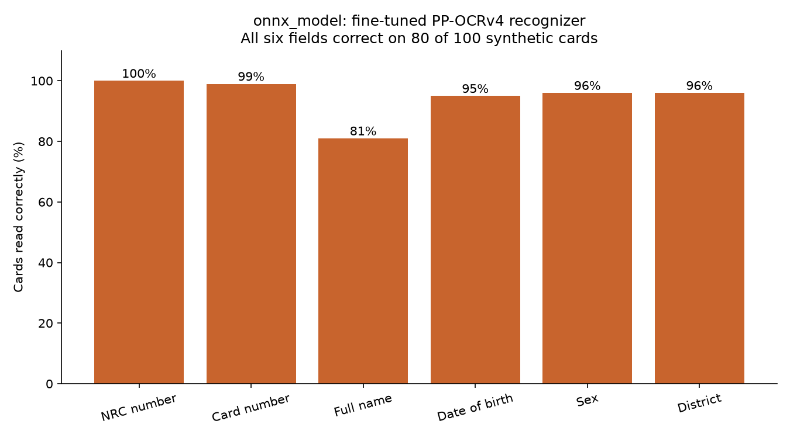
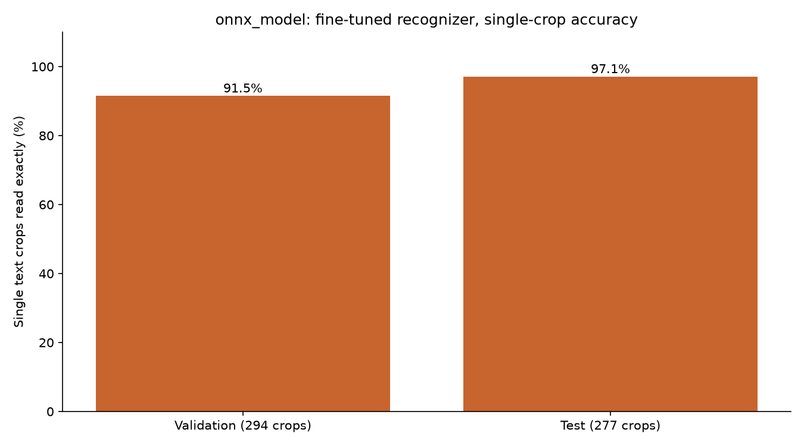

# SmartClear — AI NRC Verification for ZRA

> this is the SA team

SmartClear is a working prototype for the **ZRA AI Unit's "Strengthening Identity Verification in Taxpayer
Registration" challenge**. It runs the *extract → verify → flag → officer review* workflow from our technical
proposal, end to end and locally:

```
Scanned NRC ─▶ AI/OCR extraction ─▶ Record verification ─▶ Rule checks ─▶ Officer review
   (PDF)        NRC no., name, DOB     vs captured record     rule checks     approve / reject / escalate
```

SmartClear supports officers and does not replace them. A flag means "look closer". It is never an automated fraud decision, and records are never changed automatically.

## Quick start

Requirements: Python 3.11–3.12, Node 18+.

```bash
./run.sh                 # first run: venv, deps, frontend build, seed DB, evaluate, then serve
open http://localhost:8000
```

Sign in with **officer / smartclear** (or **supervisor / smartclear**).

`./run.sh --retrain` rebuilds the OCR cache and reseeds the synthetic set.

Frontend dev with hot reload: start the API (`cd backend && ../.venv/bin/uvicorn smartclear.api:app --reload`),
then run `cd frontend && npm run dev` and open http://localhost:5173. Vite proxies `/api` to the API.

Offline use: delete `storage/ocr_cache/` to force fresh OCR on repeat uploads (results are otherwise cached by content hash).

Tests: `cd backend && ../.venv/bin/python -m pytest -q`

### Run locally on Windows (PowerShell)

```powershell
cd <this folder>
python -m venv .venv
.\.venv\Scripts\python.exe -m pip install -r requirements.txt
cd frontend; npm install; npm run build; cd ..
cd backend
..\.venv\Scripts\python.exe -m uvicorn smartclear.api:app --host 127.0.0.1 --port 8000
```

Open http://127.0.0.1:8000 and sign in with **officer / smartclear**. Stop the server with Ctrl+C.

This branch reads text with `models/ocr/nrc_rec.onnx`. The master branch uses RapidOCR's stock model instead; everything else is the same.

## Results: onnx_model (fine-tuned PP-OCRv4 recognizer)

This branch reads text with our own recognizer, `models/ocr/nrc_rec.onnx`. It is PaddleOCR's `en_PP-OCRv4_rec` model, fine-tuned on synthetic NRC text crops (see "How the reader was trained" below).

**Whole cards.** 100 synthetic NRC cards, each field compared with the truth.



*Meaning:* each bar is the share of the 100 cards where that field was read exactly right. The full name is the weak point: 81% correct, against 99% on master. All six fields were correct on 80 of 100 cards.

**Single text crops.** The same recognizer, scored on single field crops it had not seen during training.



*Meaning:* 91.5% of 294 validation crops and 97.1% of 277 test crops were read exactly. These figures come from the Colab training run.

All metric files (charts, summary, raw results) are in the shared Google Drive folder: https://drive.google.com/drive/folders/1Rc9IH7KOoZ4Ukr1q-6L9o8-5DTLaBPPt A high crop score did not translate into a high whole-card score: small errors in each field add up, and names are most affected.

**Not yet measured:** real NRC cards. The recognizer has also not been tested end to end on real scans.

Synthetic results do not show how the system will perform on real cards.

## Real scans

No real-card accuracy has been measured on this branch. Real scans are harder than the synthetic set: they are rotated, shot at an angle, on coloured paper, or have stamps and handwriting. The card-finding step (`backend/smartclear/preprocess.py`) is written but not yet connected, so real photos still use the fixed-position reading that suits the synthetic layout. Real-scan testing needs labelled real cards, which ZRA has not yet provided.

Real scans are never stored in git. Keep them in a private folder outside the repository.

## How the reader was trained

**Why crops.** The recognizer reads one line of text at a time, so we cut each field out of the card and train on the field alone. This has three benefits:
- The synthetic generator gives each field's exact position, so every crop has a known correct text. That is the ground truth needed to score accuracy.
- Accuracy can be reported per field (NRC number, name, date of birth, and so on), which shows where errors happen.
- The model learns each field's print style without the rest of the card around it.

**What the crops contain.** Each crop is the field's box from the synthetic card, with 3 pixels of margin on each side (`backend/scripts/prepare_ocr_data.py`). Crops come from four sources, so the model sees varied print quality:
- *clean*: the original render
- *flatbed*: a simulated flatbed scan
- *phone*: a simulated phone photo
- *photocopy*: a simulated photocopy

**Splitting the data.** Splits are made by identity, never by image, so no person appears in both training and testing:

| Split | Identities | Crops |
|---|---|---|
| Train | 96 | 2,405 |
| Validation | 12 | 294 |
| Test | 12 | 277 |

**Training.** We started from PaddleOCR's pretrained English recognizer, `en_PP-OCRv4_rec_train`, and fine-tuned it (`ocr_training/configs/en_PP-OCRv4_rec_nrc.yml`):
- Batch size 64, 30 epochs, learning rate 0.0002 with one warm-up epoch.
- The backbone (the image-feature part, 4.96 million parameters) was frozen, and only the text-reading head was trained (10.3 million parameters). This was chosen so training could run on a free GPU.
- Training ran on Google Colab and Kaggle, with checkpoints saved to Google Drive so it could resume after disconnects.
- The model was exported to ONNX with `paddle2onnx`, and this file is what the app loads.

**Known problem.** The fine-tuned model sometimes invents letters inside name fields, which is why names score lowest. Adding crops with extra margin, to match the wider boxes the app produces, is the planned fix. It has not been tested yet.

The training notebooks and scripts are on the `ocr-text-extraction` branch, not on this one.

## How it works

### 1. Extraction: `backend/smartclear/extraction.py`, `backend/smartclear/cards.py`
* Real scans are normalised first: card regions are detected on the page (`cards.detect_cards`) and the page is scaled so the card matches the calibrated 924 px card width. Tighter-cropped or single-card scans pass through unchanged.
* The printed-layout variant is detected from where its labels sit. The taller "legacy green" issue gets its own zone calibration (`FIELD_BOXES_LEGACY`) and an honesty warning on every case.
* **RapidOCR** (PaddleOCR PP-OCR detection and recognition models on ONNX Runtime) runs fully on-premise.
* Pass 1: full-page OCR finds anchors (the "NATIONAL REGISTRATION CARD" title, the card number and the registration number) and estimates skew from the text-box angles.
* The page is deskewed and a card-relative coordinate frame is built, so the layout survives shifts and rotation.
* Pass 2: each field zone is cropped and re-read at 2× (2.8× for the legacy card; the name field on legacy cards additionally gets a CLAHE contrast pass). The two passes are **fused** by keeping the most confident read for each position, which recovers words the full-page detector clips at printed lines.
* Printed form labels are removed by glyph height plus fuzzy matching, weighted by OCR confidence; multi-word label phrases are also stripped deterministically.
* Dates may use 2- or 4-digit years and `.`/`/`/`-` separators.
* District fields are snapped to a gazetteer of Zambia's 116 districts (`gazetteer.py`). Personal names are never auto-corrected.
* The perforated (dot-matrix) registration number found on genuine old-issue NRCs is **not** machine-readable with this OCR stack; the system reports the number as unreadable rather than guessing. An officer must transcribe it.

### Performance: `backend/smartclear/pipeline.py`, `cards.py`, `cache.py`
* The two card sides on one page are processed **in parallel** (multi-card pages detect, crop, OCR and extract each card concurrently, then merge).
* Zone re-reads are **batched into a single OCR call** per document instead of one engine call per zone.
* A **content-hash cache** (`storage/ocr_cache/`) makes re-verifying an identical scan effectively instant (~0.3s); editing the extraction code invalidates stale entries automatically.
* Measured on a real legacy-issue scan (CPU, 4 cores): ~29s first pass, ~0.3s cached — vs ~69s before.

### 2. Verification: `backend/smartclear/verify.py`
* NRC number and DOB use **exact** matching after normalisation. DOB accepts dd.mm.yy, ISO, dd/mm/yyyy and other formats.
* Names are normalised and matched with token alignment:
  * different order, case or a 1-character typo → **match**
  * missing middle name → **partial**, for the officer to decide
  * any wholly different name → **mismatch**
* Erased fields give **unreadable**. The system never guesses.

### 3. Flagging: `backend/smartclear/flags.py`
Explainable rules:

| Code | Check |
|---|---|
| `NRC_CODE_DISTRICT` | NRC district code (e.g. `/52/` = Monze) disagrees with the place-of-birth district (reference table in `models/reference.json`) |
| `DISTRICT_INCONSISTENT` | Place-of-birth district ≠ district field |
| `UNDERAGE_REGISTRATION` | Card issued before age 16 |
| `*_UNREADABLE`, `DOB_INVALID`, `DOB_FUTURE`, `REG_BEFORE_BIRTH` | Missing, invalid or impossible values |
| `DUPLICATE_NRC` | Same NRC number previously presented with a different name |
| `RECORD_MISMATCH` | Verification failed |


It is trained on **~1,400 synthetic forgeries** made by a generator that reproduces the four alteration techniques seen in the labelled set:
* digit correction patches
* spliced digits in a different font or ink
* substituted surnames
* blur and erasure


**Risk score (0–100)** combines the rule severities and the verification outcome into three bands:
* **clear**: below 30
* **review**: 30–69
* **high**: 70 and above

### 4. Officer app: `frontend/` (React, Vite, Tailwind)
* Landing page
* Sign-in
* Dashboard with SVG charts: verification outcomes donut, risk distribution, 14-day throughput, decisions funnel, flags breakdown
* Risk-sorted review queue with pagination (10/25/50/100 rows)
* Case view: the document with evidence overlays, card vs record side by side, flags with reasons, decision buttons with keyboard shortcuts (1–4) and an audit trail
* Upload and verify, plus **batch verification** (up to 50 scans per submission, one case each)
* Taxpayer records (paginated)
* Model performance
* Audit log with CSV export (paginated)

Every submission, view and decision is written to the audit table.

## Repository layout

```
backend/smartclear/   config, document loading, extraction, gazetteer, verify, flags, pipeline, db, api
backend/scripts/      build_cache.py · seed.py
backend/tests/        pytest suite (verification, rules, live extraction)
data/synthetic_nrc/   the 100 synthetic NRC PDFs supplied for the challenge
data/ground_truth.csv     manually verified field values
data/taxpayer_records.csv synthetic "captured records" with a labelled test scenario per record
models/               reference.json
frontend/             officer web app (built into frontend/dist and served by FastAPI)
storage/              runtime only (SQLite DB, uploads, rendered images, OCR cache); git-ignored
```

## API (all under `/api`, bearer token from `POST /api/login`)

| Method | Path | Purpose |
|---|---|---|
| POST | `/login` | Officer sign-in → token |
| POST | `/cases` | Upload a PDF/image (+ optional `tpin`) → full pipeline result |
| GET | `/cases`, `/cases/{id}` | Queue (filters: `status`, `band`, `q`) and case detail |
| GET | `/cases/{id}/image` | Deskewed document image |
| POST | `/cases/{id}/review` | `approve` · `reject` · `escalate` · `request_info` (+ note) |
| GET | `/stats`, `/evaluation`, `/taxpayers`, `/audit` | Dashboard, metrics, records, audit log |

Interactive docs: http://localhost:8000/docs

## Data handling
* Development used **synthetic** NRCs plus one genuine team-supplied scan (used to develop the page normalisation and the legacy-template zones; the scan is not in this repository). Nothing leaves the machine, and no cloud OCR or LLM is called.
* Real ZRA documents should be processed only inside ZRA's controlled sandbox. See NEXT_STEPS.md.
